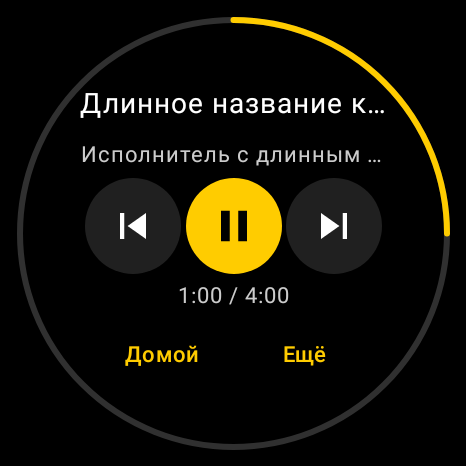
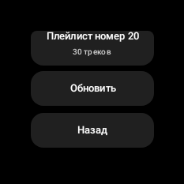

# Проверка vPlayer v0.2.1

## Изменения

- Исправлен endpoint списка плейлистов:
  `GET /users/{uid}/playlists/list`, согласно
  [yandex-music-api](https://raw.githubusercontent.com/MarshalX/yandex-music-api/master/yandex_music/_client/playlists.py).
- Владелец плейлиста читается из `owner.uid`, с fallback на `uid` и UID аккаунта.
- Сохраняется `albumId` внешней записи трека; поддержаны короткие записи без `track`.
- Все страницы списков используют одну прокрутку внутри вписанной безопасной области.
- Основной плеер компактен; дополнительные действия вынесены на страницу «Ещё».
- Включён полноэкранный режим. Геометрия рассчитана по реальным ограничениям окна Compose.

## Результаты проверки

Команда:

```bash
ANDROID_HOME=/home/user/android-sdk ./gradlew --no-daemon \
  :app:testDebugUnitTest :app:assembleRelease
```

Результат: `BUILD SUCCESSFUL`, 13 тестов, 0 ошибок и 0 пропусков.

- **PlaylistApiTest:** 8 тестов. Проверяется точный GET-путь с `/list`,
  передача авторизации, owner UID, внешние album ID, короткие записи,
  обработка HTTP 400, некорректного JSON и пустого плейлиста.
- **RoundLayoutTest:** 5 тестов. Проверяются реальные Compose bounds
  кнопок при 466×466dp / mdpi, 233×233dp / mdpi и 466×466px / 320dpi,
  нажатие play/pause, прокрутка к последнему элементу и «Назад»,
  вписанная геометрия и отсутствие перекрытия кольца прогресса.

Снимок плеера, отрисованный Robolectric для 466×466px / 320dpi:



Список на компактном окне 233×233dp, прокрученный к последнему элементу:



## APK

- `applicationId`: `com.victormuha.vplayer`
- `versionName`: `0.2.1`
- `versionCode`: `3`
- Подпись v2 подтверждена `apksigner verify`.
- SHA-256 сертификата совпадает с APK v0.2.0:
  `004322f98fc5b5860918880f1815525d09f3b27405e0ea305e71c079a3eab9f2`.
- Keystore и APK не входят в Git-репозиторий.

## Ограничения проверки

HTTP-тесты используют MockWebServer и синтетические данные без настоящего токена.
Это проверка схемы запросов и парсинга, не подтверждение работы с аккаунтом пользователя.
Robolectric проверяет разметку Android, но не особенности прошивки HarmonyOS.
Новая сборка требует повторной проверки пользователем на часах.

Если HTTP 400 сохранится, лог `adb logcat -d -s ApiClient:W` покажет endpoint,
код и доступный request ID. Заголовок Authorization и токен в лог не выводятся.
